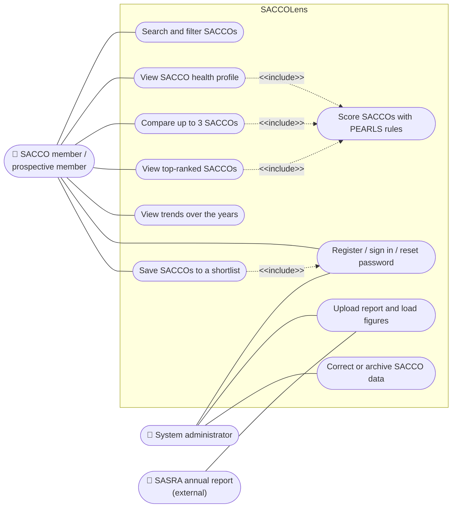
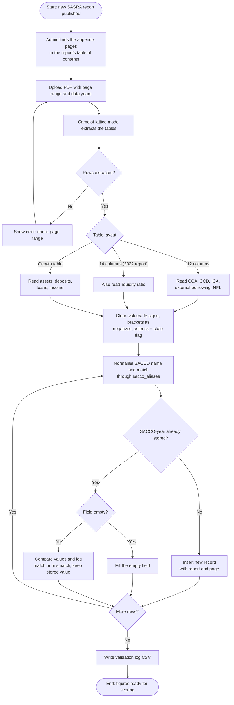
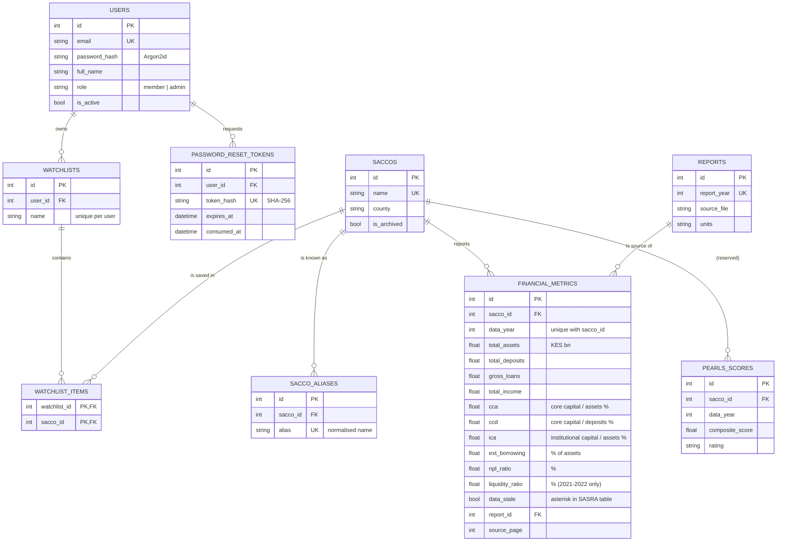
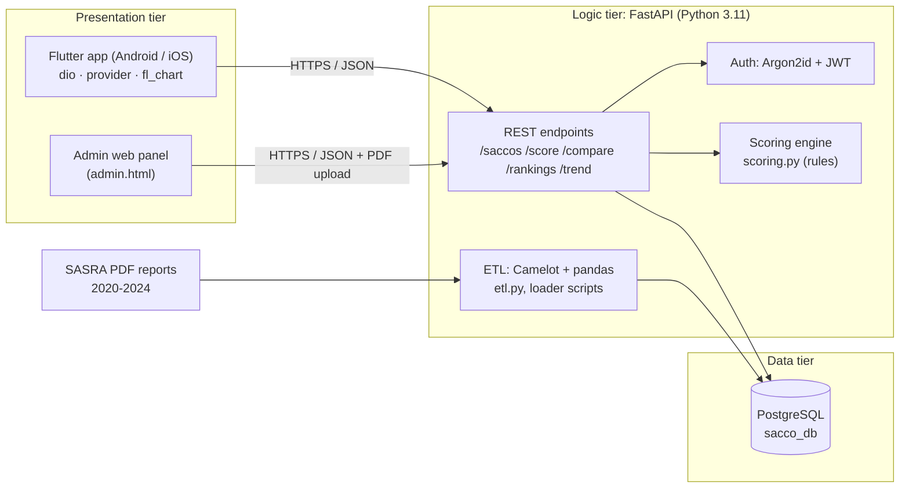

# Analysis and design diagrams (draft for Chapter 4)

The diagrams are written in Mermaid, so they stay in step with the code and can be redrawn quickly.
To turn them into images for the report: open this file in VS Code with the "Markdown Preview Mermaid
Support" extension, or paste each block into https://mermaid.live and export PNG.

Proposal section 3.4 asks for: a use case diagram, an activity diagram (ETL), a sequence diagram
(comparison), wireframes and the database schema. An architecture diagram is added for section 3.8.

## 4.x Use case diagram



Note for the write-up: searching, viewing, comparing and trends need no account; only saving does (UC7 includes UC6).

## 4.x Activity diagram: ETL pipeline



## 4.x Sequence diagram: comparing SACCOs

```mermaid
sequenceDiagram
    actor M as Member
    participant App as Flutter app<br/>(Compare tab)
    participant P as CompareProvider
    participant API as FastAPI backend<br/>GET /compare
    participant S as Scoring engine<br/>(scoring.py)
    participant DB as PostgreSQL

    M->>App: Tap "Add to compare" on two SACCOs
    App->>P: add(sacco)
    P-->>App: notify listeners (badge shows 2)
    M->>App: Open Compare tab
    App->>API: GET /compare?ids=4,5
    API->>DB: SELECT SACCOs and the years each has figures
    DB-->>API: rows
    API->>API: choose the latest year all have
    API->>DB: SELECT figures for that year and the year before; peer incomes
    DB-->>API: financial_metrics rows
    loop for each SACCO
        API->>S: score_sacco(metric, prior, peer median, inflation)
        S-->>API: dimensions, composite, rating, overrides, flags
    end
    API-->>App: 200 {year, results, ranking}
    App->>App: rank (ties are joint), draw radar and table
    App-->>M: Side-by-side comparison
    alt server unreachable
        API--xApp: no response
        App-->>M: "Could not reach the server" + Try again
    end
```

## 4.x Database schema (ERD)



Every table also has `created_at` and `updated_at`. An `audit_logs` table records admin changes
(entity, action, actor, before and after values). `pearls_scores` is kept for a future cache; scores
are currently computed on request so they always follow the current rules.

## 4.x System architecture (three-tier)



## 4.x Wireframes

Screenshots of the working prototype are in `docs/chapter4/screens/` (taken from the Android
emulator). Use them as the screen-by-screen reference the proposal asks for, with one line under
each saying what the member can do there.
